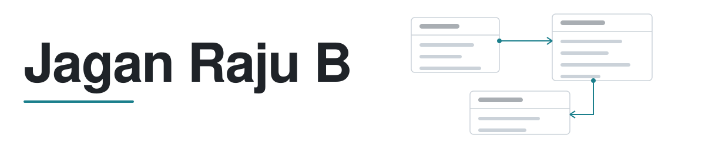

<picture>
  <source media="(prefers-color-scheme: dark)" srcset="assets/header-dark.svg">
  <source media="(prefers-color-scheme: light)" srcset="assets/header-light.svg">
  
</picture>

Third-year Information Science and Engineering student at The National Institute of Engineering, Mysuru. I build full-stack systems and applied machine learning, with particular attention to database design, access control, and being transparent about what a project does and doesn't do yet.

## Selected work

### Farm Connect

A marketplace that connects farmers with buyers nearby. Customers sign in with a phone OTP, find produce by distance using the Haversine formula, and place Cash-on-Delivery orders that check stock as they are placed. An admin dashboard handles farmer verification.

**My part:** I led a team of three in the IEEE Computer Society IAMPro'26 programme. My technical role was full-stack and database lead: architecture, database design, backend services and deployment.

**Known limits:** payments are Cash-on-Delivery only, and notifications poll every 10 seconds instead of using WebSockets.

**Stack:** Next.js, React, TypeScript, Tailwind CSS, Express, PostgreSQL on Supabase

[Repository](https://github.com/JaganRaju07/farm-connect) · [Live demo](https://farm-connect-eta-ten.vercel.app)

### AI Malware Detection

A web workstation that compares seven machine-learning models on one question: does a program's behaviour when it runs look like ransomware? Validation keeps duplicate samples on the same side of every split, so near-copies cannot inflate the scores, and model selection never looks at the held-out test set. Predictions come with explanations, using SHAP for the tree-based models and coefficients for logistic regression, and behavioural indicators are mapped to MITRE ATT&CK techniques.

**My part:** one of four students on the project; I maintain the repository and the implementation.

**Known limits:** it is a university minor project built on a single public dataset with no live sandbox, so its scores describe that dataset and not real-world detection. The demo runs on a free instance that sleeps when idle, so the first load can take about a minute.

**Stack:** Python, scikit-learn, SHAP, React, Docker

[Repository](https://github.com/JaganRaju07/AI-Malware_Detection) · [Live demo](https://ai-malware-defense-soc.onrender.com)

### HostelMS

A hostel administration system that takes a student from registration to room allocation, monthly fees and complaints. Admin and Student portals are kept apart with Spring Security authorities, and passwords are hashed with BCrypt. It is a server-rendered Spring MVC application.

**My part:** solo project.

**Known limits:** it runs locally with no hosted demo. Its README lists what is still missing, including transactions around room allocation and fee generation, and integration tests.

**Stack:** Java 17, Spring Boot, Spring MVC, JPA, MySQL, Thymeleaf

[Repository](https://github.com/JaganRaju07/HostelMS)

### NISB Digital Archive

A searchable archive of the student branch's office bearers, societies and milestones, with a curator portal for drafting, verifying and publishing records. Public pages read only published, verified records through restricted database views, every write passes a server-side admin check, and any field without a published source is left empty instead of guessed.

**My part:** I build and maintain it.

**Status:** under active development; records are added as the committee supplies them.

**Stack:** Next.js, React, TypeScript, Tailwind CSS, Supabase, Zod

[Repository](https://github.com/JaganRaju07/NISB)

## Also built

- **[DonorNet](https://github.com/JaganRaju07/DonorNet):** a blood and organ donor network for a DBMS course, with an emergency request board, donor matching and an organ-pledge workflow. React, Express, MySQL.
- **[Agri Trade Ledger](https://github.com/JaganRaju07/Agri-trade-dashboard):** an offline D3 dashboard over FAOSTAT trade data for 2000 to 2024 (31,571 records) that reproduces a Power BI report across 12 pages, built with a lab partner for the Data Visualization Lab.

## Stack

- **Languages:** Java, TypeScript, JavaScript, Python, SQL
- **Web:** Next.js, React, Tailwind CSS, Node.js and Express, Spring Boot, D3
- **Data:** PostgreSQL, MySQL, Supabase (Auth, row-level security)
- **Machine learning:** scikit-learn, SHAP, pandas
- **Practice:** Git, Docker, JWT and bcrypt authentication, Vercel, Render

## Community

- **IEEE NIE Student Branch (NISB):** executive committee member as Computer Society Tech Lead and Student Branch Networking Coordinator. Built the participant platform for the Computer Society's OSINT challenge, Operation Phantom CTF, and hosted NISB Xtreme, the branch's coding contest.
- **IEEE Xtreme 20.0:** Student Branch Ambassador for NISB.
- **IEEE Computer Society Bangalore Chapter, IAMPro'26:** completed the six-month internship and mentorship programme (April to September 2026), leading the Farm Connect team.

## Contact

[jaganrajub07@gmail.com](mailto:jaganrajub07@gmail.com) · [LinkedIn](https://www.linkedin.com/in/jagan-raju)