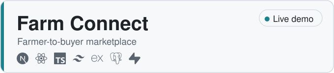
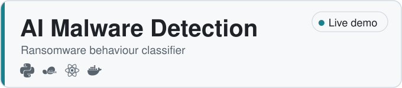
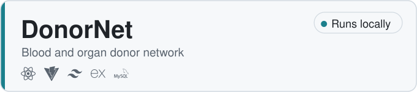
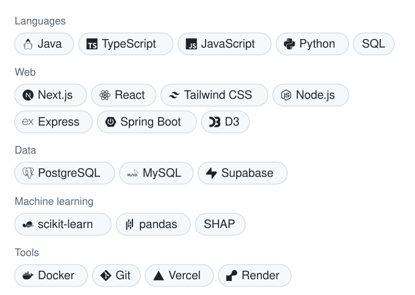

<picture>
  <source media="(prefers-color-scheme: dark)" srcset="assets/header-dark.svg">
  <source media="(prefers-color-scheme: light)" srcset="assets/header-light.svg">
  
</picture>

Third-year Information Science and Engineering student at The National Institute of Engineering, Mysuru. I build full-stack systems and applied machine learning, with particular attention to database design, access control, and being transparent about what a project does and doesn't do yet.

[Email](mailto:jaganrajub07@gmail.com) · [LinkedIn](https://www.linkedin.com/in/jagan-raju) · [Projects](#featured-projects)

## Featured projects

<a href="https://github.com/JaganRaju07/farm-connect">
  <picture>
    <source media="(prefers-color-scheme: dark)" srcset="assets/card-farm-connect-dark.svg">
    
  </picture>
</a>

- Phone-OTP login, distance-based produce discovery, stock-checked Cash-on-Delivery orders, and an admin dashboard for farmer verification.
- **My role:** led the three-person IAMPro'26 team as full-stack and database lead: architecture, schema, backend services and deployment.
- **Limits:** payments are Cash-on-Delivery only, and notifications poll every 10 seconds instead of using WebSockets.

[Repository](https://github.com/JaganRaju07/farm-connect) · [Live demo](https://farm-connect-eta-ten.vercel.app)

<a href="https://github.com/JaganRaju07/AI-Malware_Detection">
  <picture>
    <source media="(prefers-color-scheme: dark)" srcset="assets/card-ai-malware-detection-dark.svg">
    
  </picture>
</a>

- Compares seven machine-learning models on whether a program's behaviour looks like ransomware. Duplicate-aware validation stops near-copies inflating the scores, model selection never sees the held-out test set, and predictions are explained with SHAP (tree models) or coefficients (logistic regression), alongside MITRE ATT&CK mapping.
- **My role:** one of four students; I maintain the repository and the implementation.
- **Limits:** one public dataset and no live sandbox, so results describe that dataset, not real-world detection. The demo runs on a free instance, so the first load can take about a minute.

[Repository](https://github.com/JaganRaju07/AI-Malware_Detection) · [Live demo](https://ai-malware-defense-soc.onrender.com)

<a href="https://github.com/JaganRaju07/HostelMS">
  <picture>
    <source media="(prefers-color-scheme: dark)" srcset="assets/card-hostelms-dark.svg">
    
  </picture>
</a>

- Takes a student from registration to room allocation, monthly fees and complaints. Admin and Student portals are separated with Spring Security authorities, passwords are BCrypt-hashed, and pages are server-rendered with Spring MVC.
- **My role:** solo project.
- **Limits:** runs locally with no hosted demo. Its README lists open gaps, including transactions around room allocation and fee generation, and integration tests.

[Repository](https://github.com/JaganRaju07/HostelMS)

<a href="https://github.com/JaganRaju07/DonorNet">
  <picture>
    <source media="(prefers-color-scheme: dark)" srcset="assets/card-donornet-dark.svg">
    
  </picture>
</a>

- Emergency network linking hospitals, blood banks and donors: a prioritised request board, donor matching, a facility directory, and an organ-pledge workflow from pledge to hospital acceptance. Role-based logins for administrators and donors, JWT and bcrypt authentication, Helmet and rate limiting.
- **Context:** BCS403 DBMS course project at NIE Mysuru.
- **Limits:** runs locally from the provided SQL scripts; no hosted demo is linked.

[Repository](https://github.com/JaganRaju07/DonorNet)

**Also built:** [NISB Digital Archive](https://github.com/JaganRaju07/NISB), a searchable archive of the student branch's office bearers, societies and milestones with a curator portal (Next.js, Supabase), in active development; and [Agri Trade Ledger](https://github.com/JaganRaju07/Agri-trade-dashboard), an offline D3 dashboard over 31,571 FAOSTAT trade records (2000 to 2024) that reproduces a 12-page Power BI report, built with a lab partner.

## Stack

<picture>
  <source media="(prefers-color-scheme: dark)" srcset="assets/stack-dark.svg">
  
</picture>

Also used: JWT and bcrypt authentication, Supabase Auth and row-level security.

## Activity

<picture>
  <source media="(prefers-color-scheme: dark)" srcset="https://raw.githubusercontent.com/JaganRaju07/JaganRaju07/output/github-snake-dark.svg">
  
</picture>

## Community

- **IEEE NIE Student Branch (NISB):** executive committee member as Computer Society Tech Lead and Student Branch Networking Coordinator. Built the participant platform for the Computer Society's OSINT challenge, Operation Phantom CTF, and hosted NISB Xtreme, the branch's coding contest.
- **IEEE Xtreme 20.0:** Student Branch Ambassador for NISB.
- **IEEE Computer Society Bangalore Chapter, IAMPro'26:** completed the six-month internship and mentorship programme (April to September 2026), leading the Farm Connect team.